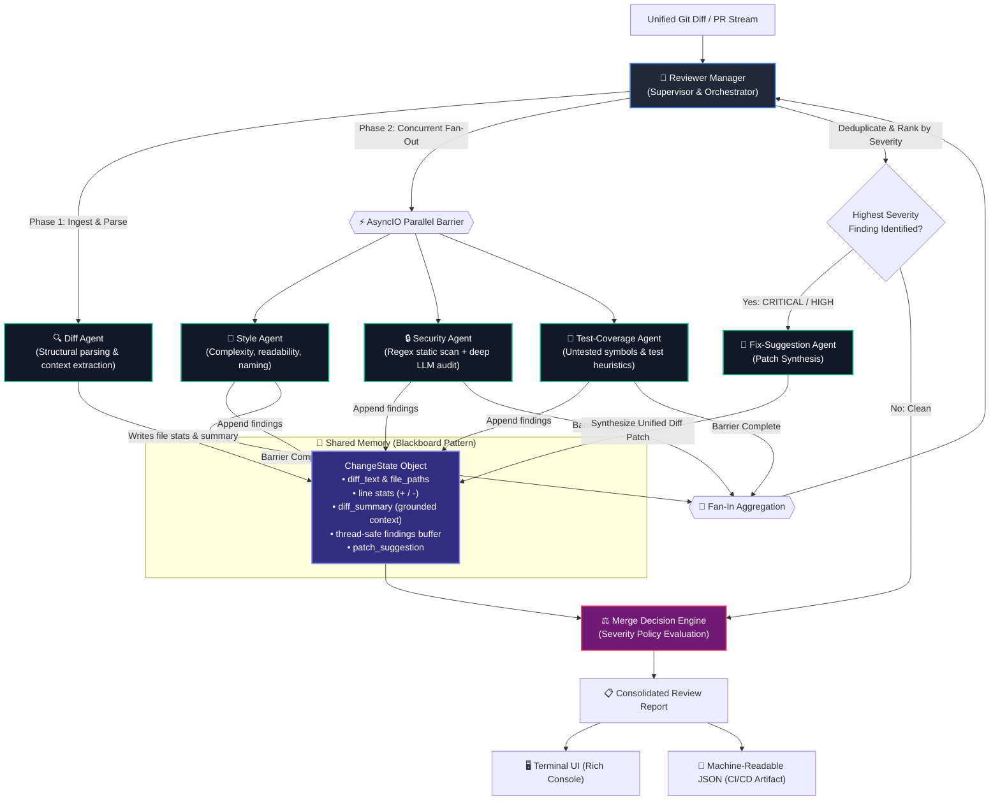
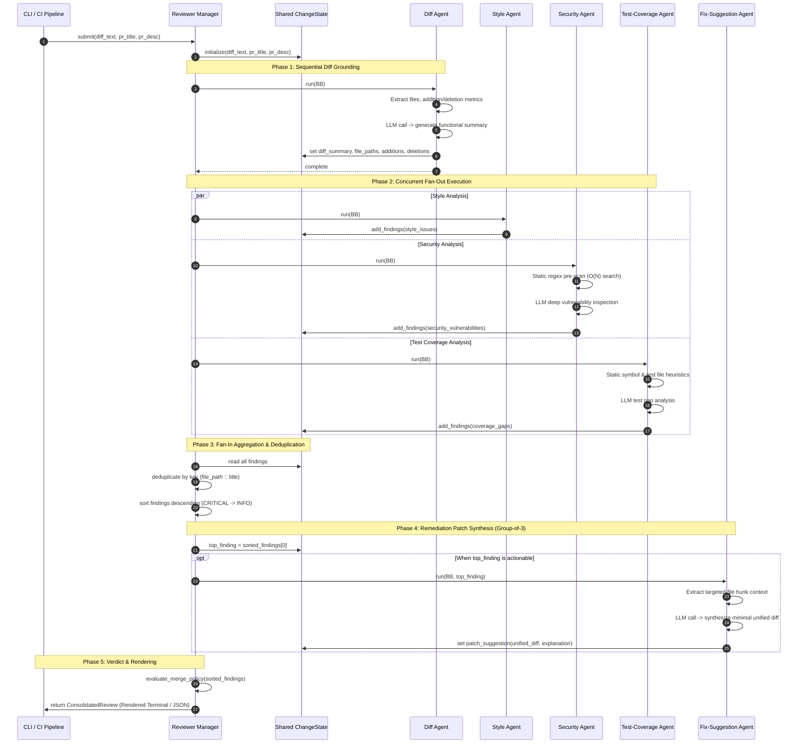

# Automated Code Review Board (ACRB)
### Enterprise Multi-Agent Pull Request Review & Autonomous Merge Gate System
*Group 14 — Project Implementation*

[](https://www.python.org/)
[](https://github.com/microsoft/semantic-kernel)
[](https://docs.pydantic.dev/)
[]()
[]()

---

## 1. Executive Summary & System Classification

The **Automated Code Review Board (ACRB)** is an enterprise-grade multi-agent autonomous system designed to review incoming code diffs, evaluate security vulnerabilities, enforce stylistic and architectural standards, audit automated test coverage, and synthesize concrete remediation patches. The system culminates in a single, consolidated review report with a deterministic **Merge Recommendation** (`APPROVE`, `COMMENT`, or `REQUEST_CHANGES`).

### System Categorization & Paradigms

```
┌─────────────────────────────────────────────────────────────────────────────┐
│                           SYSTEM CLASSIFICATION                             │
├──────────────────────────┬──────────────────────────────────────────────────┤
│ Coordination Pattern     │ Asynchronous Fan-Out / Fan-In with Hierarchical  │
│                          │ Supervisor (Reviewer Manager)                    │
├──────────────────────────┼──────────────────────────────────────────────────┤
│ Shared Memory Pattern    │ Blackboard Architecture with Thread-Safe Locks   │
│                          │ (`ChangeState` unified context object)           │
├──────────────────────────┼──────────────────────────────────────────────────┤
│ Inspection Methodology   │ Hybrid: Multi-Tiered Static Heuristic Filters +  │
│                          │ Grounded LLM Contextual Reasoning                │
├──────────────────────────┼──────────────────────────────────────────────────┤
│ Agent Paradigm           │ Heterogeneous Specialist Agents (Role-Based)     │
├──────────────────────────┼──────────────────────────────────────────────────┤
│ Fault-Tolerance Model    │ Isolated Agent Execution with Graceful Failure   │
│                          │ Degradation                                      │
├──────────────────────────┼──────────────────────────────────────────────────┤
│ Decision Engine          │ Deterministic Monotonic Severity Gating          │
└──────────────────────────┴──────────────────────────────────────────────────┘
```

---

## 2. System Architecture

The ACRB coordinates specialist agents using a **Hierarchical Supervisor** pattern implementing a **Fan-Out / Fan-In** topology backed by a **Shared Blackboard Memory** (`ChangeState`).

### 2.1 Component Topology



### 2.2 End-to-End Sequence Diagram



---

## 3. Core Engineering Approaches

### 3.1 Asynchronous Fan-Out / Fan-In Coordination
- **Staged Pipeline**: To minimize LLM hallucination and maximize precision, the pipeline is staged. The `DiffAgent` runs first (Phase 1) to establish the grounded baseline summary. Specialist agents (`StyleAgent`, `SecurityAgent`, `TestCoverageAgent`) then execute concurrently in Phase 2 via Python's non-blocking `asyncio.gather()`.
- **Fan-In Deduplication**: Findings emitted from parallel agents can overlap (e.g. `SecurityAgent` and `StyleAgent` both reporting an unsafe construct). The Reviewer Manager computes a normalized hash key:
  $$\text{Key} = \text{file\_path} \parallel \text{normalize}(\text{title})$$
  When a collision occurs, the finding with the **higher severity** is preserved, discarding the lower-severity duplicate.

### 3.2 Blackboard Architecture (Shared Change-State Memory)
Rather than passing sprawling messages through an agent chain, all agents interact through an in-memory **Blackboard** object (`ChangeState` in `models/shared_state.py`):
- **Immutable Context**: Raw diff, PR title, and PR description are read-only to specialist workers.
- **Thread-Safe Mutation**: Findings are appended via `add_finding()` and `add_findings()` guarded by an internal lock (`threading.Lock` / `pydantic.PrivateAttr`), preventing race conditions during asynchronous or threaded agent completion.
- **Full Traceability**: Every finding records its author agent (`agent`), severity category, file path, line number, code snippet, and actionable recommendation.

### 3.3 Hybrid Inspection: Fast Static Heuristics + Grounded LLMs
To achieve industrial reliability and cost-efficiency:
1. **Tier-1 Static Pre-Filter ($O(N)$ Deterministic Scan)**:
   - Evaluates added lines (`+`) without consuming LLM tokens.
   - Detects hard-coded passwords, secrets, AWS keys (`AKIA[0-9A-Z]{16}`), unsafe deserialization (`pickle.loads`), command injection (`subprocess.run(..., shell=True)`, `os.system`), and broken crypto (`hashlib.md5`, `hashlib.sha1`).
   - Detects missing test files (e.g. modifying `app/auth.py` without including a corresponding test file `tests/test_auth.py`).
2. **Tier-2 Semantic LLM Deep Audit**:
   - Analyzes complex multi-line logic, missing boundary validations, improper state transitions, and architectural antipatterns.
   - Grounded against the `diff_summary` generated in Phase 1.

### 3.4 Remediation Patch Synthesis (Group-of-3 Feature)
Rather than merely flagging errors, the system includes a dedicated **Fix-Suggestion Agent** (`agents/fix_suggestion_agent.py`):
- Automatically isolates the **single highest-severity finding** across all agents.
- Extracts the exact file diff context hunk.
- Synthesizes a concrete, syntactically valid **unified diff patch** (`--- a/... +++ b/... @@ ... @@`) accompanied by a technical rationale.
- Ready to be applied directly via `git apply`.

### 3.5 Fault-Tolerant Agent Isolation
Agent execution in the Reviewer Manager is wrapped in isolated exception handlers:
```python
await asyncio.gather(
    self._run_agent(self.style_agent, state, "StyleAgent"),
    self._run_agent(self.security_agent, state, "SecurityAgent"),
    self._run_agent(self.test_agent, state, "TestCoverageAgent"),
)
```
If an individual agent encounters a network timeout, malformed model response, or rate limit, it injects a low-severity system observation finding into the blackboard without terminating sibling agents or causing the review pipeline to crash.

---

## 4. Specialized Agents

| Agent Module | Component Class | Core Responsibilities | Severity Band |
|---|---|---|---|
| [`agents/diff_agent.py`](file:///c:/Users/Utkarsh/Desktop/AUTOMATED_CODE_REVIEW_BOARD/agents/diff_agent.py) | `DiffAgent` | • Parses file paths from git diff headers.<br>• Calculates additions and deletions.<br>• Generates 3-6 sentence functional summary.<br>• Flags PR-splitting alerts for large diffs (>500 lines). | `INFO`, `LOW` |
| [`agents/style_agent.py`](file:///c:/Users/Utkarsh/Desktop/AUTOMATED_CODE_REVIEW_BOARD/agents/style_agent.py) | `StyleAgent` | • Enforces naming conventions (PEP 8 / camelCase consistency).<br>• Detects high cyclomatic complexity and deeply nested branches.<br>• Flags missing docstrings on public APIs.<br>• Identifies magic numbers and unreachable dead code. | `MEDIUM`, `LOW` |
| [`agents/security_agent.py`](file:///c:/Users/Utkarsh/Desktop/AUTOMATED_CODE_REVIEW_BOARD/agents/security_agent.py) | `SecurityAgent` | • Executes regex scans for hardcoded secrets/credentials/tokens.<br>• Checks for SQL, OS command, and LDAP injection vectors.<br>• Flags dangerous deserialization (`pickle`, `eval`, `exec`).<br>• Audits weak hashing algorithms and debug flags left in production. | `CRITICAL`, `HIGH`, `MEDIUM` |
| [`agents/test_coverage_agent.py`](file:///c:/Users/Utkarsh/Desktop/AUTOMATED_CODE_REVIEW_BOARD/agents/test_coverage_agent.py) | `TestCoverageAgent` | • Scans for new classes and functions introduced in the diff.<br>• Checks if a matching test file is present in the PR.<br>• Flags weakened or removed test assertions.<br>• Identifies untested edge cases (null inputs, boundary conditions). | `HIGH`, `MEDIUM`, `LOW` |
| [`agents/reviewer_manager.py`](file:///c:/Users/Utkarsh/Desktop/AUTOMATED_CODE_REVIEW_BOARD/agents/reviewer_manager.py) | `ReviewerManager` | • Orchestrates the Fan-Out and Fan-In sequence.<br>• Deduplicates and monotonically sorts findings.<br>• Coordinates the Fix-Suggestion Agent.<br>• Applies merge gate policies to compute the final verdict. | Orchestrator |
| [`agents/fix_suggestion_agent.py`](file:///c:/Users/Utkarsh/Desktop/AUTOMATED_CODE_REVIEW_BOARD/agents/fix_suggestion_agent.py) | `FixSuggestionAgent` | • Inspects the single highest-severity finding.<br>• Generates an immediate unified diff patch.<br>• Writes technical explanation for the proposed patch. | Remediation |

---

## 5. Severity Ranking & Merge Decision Engine

### 5.1 Severity Hierarchy

The system defines an explicit integer-backed severity hierarchy (`models/finding.py`):

$$\text{CRITICAL } (5) > \text{HIGH } (4) > \text{MEDIUM } (3) > \text{LOW } (2) > \text{INFO } (1)$$

```python
class Severity(IntEnum):
    INFO = 1       # Contextual notes, diff size alerts
    LOW = 2        # Minor style or hygiene suggestions
    MEDIUM = 3     # Complexity issues, missing non-critical validation
    HIGH = 4       # Untested critical paths, deprecated crypto, missing auth
    CRITICAL = 5   # Credential leaks, RCE, SQL injection
```

### 5.2 Deterministic Merge Policy Rules

The Reviewer Manager applies a strict state-machine decision table:

```
┌───────────────────────────────────────┬───────────────────┬────────────────────────────────────────────────────────┐
│ Condition                             │ Recommendation    │ Policy Rationale                                       │
├───────────────────────────────────────┼───────────────────┼────────────────────────────────────────────────────────┤
│ Count(CRITICAL) > 0                   │ REQUEST_CHANGES   │ Merge blocked. Immediate exploit or secret exposure.   │
├───────────────────────────────────────┼───────────────────┼────────────────────────────────────────────────────────┤
│ Count(HIGH) > 0                       │ REQUEST_CHANGES   │ Merge blocked. Untested logic or severe vulnerability. │
├───────────────────────────────────────┼───────────────────┼────────────────────────────────────────────────────────┤
│ Count(MEDIUM) > 0                     │ COMMENT           │ Non-blocking. Approves with comments to fix in sprint. │
├───────────────────────────────────────┼───────────────────┼────────────────────────────────────────────────────────┤
│ Count(LOW) > 0 or Count(INFO) >= 0   │ APPROVE           │ Safe to merge. Only cosmetic or informational notes.   │
├───────────────────────────────────────┼───────────────────┼────────────────────────────────────────────────────────┤
│ Count(Findings) == 0                  │ APPROVE           │ Safe to merge. Flawless diff.                          │
└───────────────────────────────────────┴───────────────────┴────────────────────────────────────────────────────────┘
```

---

## 6. Data Contracts & Schemas

The system leverages **Pydantic v2** models with strict type validation.

### 6.1 Finding Model (`models/finding.py`)
```python
class Finding(BaseModel):
    id: str = Field(default_factory=lambda: str(uuid.uuid4()))
    agent: str                                 # Reporting agent name
    severity: Severity                         # Ordered IntEnum
    category: str                              # "security", "style", "test-coverage", "diff"
    title: str                                 # One-line summary
    description: str                           # Detailed technical assessment
    file_path: Optional[str] = None            # Target file path
    line_number: Optional[int] = None          # Approximate line in new file
    code_snippet: Optional[str] = None         # Offending code excerpt
    suggestion: Optional[str] = None           # Concise mitigation recommendation

    model_config = ConfigDict(use_enum_values=False)
```

### 6.2 ChangeState Blackboard (`models/shared_state.py`)
```python
class ChangeState(BaseModel):
    diff_text: str = ""                        # Raw unified diff
    pr_title: str = ""                         # PR title
    pr_description: str = ""                   # PR description
    file_paths: List[str] = Field(default_factory=list)
    additions: int = 0
    deletions: int = 0
    diff_summary: str = ""                     # Phase 1 DiffAgent summary
    findings: List[Finding] = Field(default_factory=list)
    patch_suggestion: Optional[Patch] = None   # Phase 4 Patch from FixAgent
    
    _lock: threading.Lock = PrivateAttr(default_factory=threading.Lock)
    model_config = ConfigDict(arbitrary_types_allowed=True)
```

### 6.3 Patch Model (`models/shared_state.py`)
```python
class Patch(BaseModel):
    finding_id: str                            # Associated Finding UUID
    finding_title: str                         # Finding title
    file_path: Optional[str] = None            # File target
    unified_diff: str = ""                     # Git-compliant patch hunk
    explanation: str = ""                      # Technical explanation of the fix
```

---

## 7. Installation & Setup

### 7.1 Prerequisites
- Python 3.10, 3.11, or 3.12
- Active OpenAI API Key or Azure OpenAI Endpoint

### 7.2 Installation
```bash
# Clone repository
git clone https://github.com/your-org/automated-code-review-board.git
cd automated-code-review-board

# Create virtual environment
python -m venv venv
# Linux / macOS
source venv/bin/activate
# Windows PowerShell
.\venv\Scripts\Activate.ps1

# Install dependencies
pip install -r requirements.txt
```

### 7.3 Environment Configuration
Create a `.env` file from the provided `.env.example`:
```bash
cp .env.example .env
```

Edit `.env` to configure your LLM provider:

```env
# Standard OpenAI Configuration
OPENAI_API_KEY=sk-proj-xxxxxxxxxxxxxxxxxxxxxxxx
OPENAI_MODEL=gpt-4o-mini

# Optional: Azure OpenAI Service Configuration
AZURE_OPENAI_ENDPOINT=https://your-resource.openai.azure.com/
AZURE_OPENAI_API_KEY=your_azure_api_key
AZURE_OPENAI_DEPLOYMENT=gpt-4o-mini
AZURE_OPENAI_API_VERSION=2024-02-15-preview
```

---

## 8. CLI Reference & Operational Usage

The system exposes a versatile command-line interface in [`main.py`](file:///c:/Users/Utkarsh/Desktop/AUTOMATED_CODE_REVIEW_BOARD/main.py).

### 8.1 Command Line Options
```
usage: main.py [-h] [--diff FILE | --stdin | --demo] [--pr-title TEXT]
               [--pr-desc TEXT] [--json-out FILE]
               [--log-level {DEBUG,INFO,WARNING,ERROR}]

Automated Code Review Board — multi-agent PR reviewer

options:
  -h, --help            Show this help message and exit
  --diff FILE           Path to a unified diff file (.diff, .patch)
  --stdin               Read diff stream from standard input
  --demo                Execute against the built-in flawed authentication demo diff
  --pr-title TEXT       Pull request or commit title
  --pr-desc TEXT        Pull request description
  --json-out FILE       Export full structured review report to JSON
  --log-level LEVEL     Set logging verbosity (DEBUG, INFO, WARNING, ERROR)
```

### 8.2 Execution Examples

#### 1. Running the Built-in Demo
Demonstrates the multi-agent board analyzing intentional vulnerabilities (hardcoded secrets, `eval()`, missing tests, cyclomatic complexity):
```bash
python main.py --demo
```

#### 2. Reviewing a Local Diff File
```bash
python main.py --diff sample_diff.diff
```

#### 3. Reviewing with JSON Export (CI/CD Artifact Generation)
```bash
python main.py --diff sample_diff.diff --json-out review_report.json
```

#### 4. Direct Git Pipeline Integration (Piping from stdin)
```bash
# Review uncommitted working directory changes
git diff | python main.py --stdin

# Review the latest commit
git diff HEAD~1 | python main.py --stdin --pr-title "Latest commit review"
```

---

## 9. Enterprise CI/CD Pipeline Integration

The ACRB can be integrated directly into GitHub Actions or GitLab CI to function as an autonomous merge gate.

### GitHub Actions Workflow Example (`.github/workflows/code-review.yml`)

```yaml
name: Automated Code Review Board

on:
  pull_request:
    types: [opened, synchronize, reopened]

jobs:
  review:
    name: Multi-Agent Review Board
    runs-on: ubuntu-latest
    permissions:
      contents: read
      pull-requests: write

    steps:
      - name: Checkout Code
        uses: actions/checkout@v4
        with:
          fetch-depth: 0

      - name: Set up Python
        uses: actions/setup-python@v5
        with:
          python-version: "3.10"
          cache: "pip"

      - name: Install Dependencies
        run: pip install -r requirements.txt

      - name: Generate PR Diff
        run: |
          git diff origin/${{ github.base_ref }}...HEAD > pr.diff

      - name: Execute Automated Code Review
        env:
          OPENAI_API_KEY: ${{ secrets.OPENAI_API_KEY }}
          OPENAI_MODEL: "gpt-4o-mini"
        run: |
          python main.py --diff pr.diff \
                         --pr-title "${{ github.event.pull_request.title }}" \
                         --pr-desc "${{ github.event.pull_request.body }}" \
                         --json-out review.json

      - name: Check Merge Verdict
        run: |
          RECOMMENDATION=$(python -c "import json; print(json.load(open('review.json'))['merge_recommendation'])")
          echo "Merge Recommendation: $RECOMMENDATION"
          if [ "$RECOMMENDATION" = "REQUEST_CHANGES" ]; then
            echo "❌ Review Board blocked the merge due to CRITICAL or HIGH findings."
            exit 1
          fi
```

---

## 10. Automated Test Suite & Verification

The codebase includes an industrial test suite containing **58 automated tests** implemented with `pytest` across unit, heuristic, and mocked-agent integration boundaries.

```bash
# Execute entire test suite
python -m pytest tests/ -v
```

### Test Suite Structure

| Test File | Test Suite Focus | Test Count |
|---|---|:---:|
| [`tests/test_models.py`](file:///c:/Users/Utkarsh/Desktop/AUTOMATED_CODE_REVIEW_BOARD/tests/test_models.py) | • `Severity` ordering & factory methods.<br>• `Finding` instantiation & normalization key generation.<br>• `ChangeState` thread-safe mutations & sorting.<br>• `Patch` and `ConsolidatedReview` serialization. | 18 |
| [`tests/test_agents_static.py`](file:///c:/Users/Utkarsh/Desktop/AUTOMATED_CODE_REVIEW_BOARD/tests/test_agents_static.py) | • `DiffAgent` header parsing, additions/deletions line counters.<br>• `SecurityAgent` regex static scanner (passwords, tokens, `eval`, `pickle`, MD5).<br>• `TestCoverageAgent` static heuristics and missing test detection.<br>• `ReviewerManager` deduplication algorithm & merge recommendation rules. | 28 |
| [`tests/test_pipeline_integration.py`](file:///c:/Users/Utkarsh/Desktop/AUTOMATED_CODE_REVIEW_BOARD/tests/test_pipeline_integration.py) | • End-to-end multi-agent pipeline orchestration.<br>• Phase 1 summary generation verification.<br>• Phase 2 concurrent fan-out execution with mocked LLMs.<br>• Phase 3 fan-in deduplication verification.<br>• Phase 4 Fix-Suggestion Agent patch generation.<br>• Edge cases: empty diffs, all-clean diffs. | 12 |
| **Total Passed** | **Zero failures, zero warnings** | **58 / 58** |

---

## 11. Project Directory Structure

```
AUTOMATED_CODE_REVIEW_BOARD/
├── agents/                                # Specialized Agent Modules
│   ├── __init__.py                        # Agent exports
│   ├── base_agent.py                      # Semantic Kernel base class & LLM connectors
│   ├── diff_agent.py                      # Diff Agent: parsing & functional summarization
│   ├── style_agent.py                     # Style Agent: readability & complexity audit
│   ├── security_agent.py                  # Security Agent: static regex + LLM deep scan
│   ├── test_coverage_agent.py             # Test-Coverage Agent: heuristics & gap analysis
│   ├── fix_suggestion_agent.py            # Fix-Suggestion Agent (Group-of-3 patch generator)
│   └── reviewer_manager.py                # Reviewer Manager: orchestrator & merge decision
├── models/                                # Shared Blackboard & Typed Data Contracts
│   ├── __init__.py                        # Model exports
│   ├── finding.py                         # Finding & Severity models
│   └── shared_state.py                    # ChangeState, Patch, ConsolidatedReview
├── tests/                                 # 58-Test Verification Suite
│   ├── __init__.py
│   ├── test_models.py                     # Unit tests for schemas & thread safety
│   ├── test_agents_static.py              # Unit tests for regex & heuristics
│   └── test_pipeline_integration.py       # Integration tests for fan-out/fan-in pipeline
├── .env.example                           # Template environment configuration
├── config.py                              # Central configuration & settings loader
├── main.py                                # CLI entry point with --diff, --demo, --stdin
├── renderer.py                            # Rich terminal visualizer & JSON serializer
├── requirements.txt                       # Project dependencies
├── sample_diff.diff                       # Deliberately flawed diff for demonstrations
└── README.md                              # Industrial-grade documentation
```

---

## 12. Authors & Acknowledgements

- **Group 14**: Automated Code Review Board Team
- **Orchestration Framework**: Microsoft Semantic Kernel
- **Validation Engine**: Pydantic v2
- **UI Terminal Rendering**: Rich
