# Group 14 — Automated Code Review Board

A production-ready multi-agent system that automates code reviews and pull request evaluation using **Semantic Kernel**, **asynchronous fan-out / fan-in coordination**, a **shared change-state memory**, and **collaborative task execution** across specialized agents.

---

## 🏛 Architecture

```mermaid
flowchart TD
    INPUT["📄 Code Diff / PR Input"] --> RM["🎯 Reviewer Manager\n(Orchestrator)"]
    
    subgraph FanOut["Phase 1 & 2: Execution"]
        DA["🔍 Diff Agent\n(file touched, diff statistics & plain summary)"]
        SA["🎨 Style Agent\n(naming, complexity, formatting, docstrings)"]
        SEC["🔒 Security Agent\n(unsafe patterns, static rules, secrets, CVEs)"]
        TC["🧪 Test-Coverage Agent\n(untested functions, missing test cases)"]
    end

    RM -->|1. Parse & Summarize| DA
    DA -->|diff_summary in shared state| RM
    RM -->|2. Concurrent Fan-Out| SA
    RM -->|2. Concurrent Fan-Out| SEC
    RM -->|2. Concurrent Fan-Out| TC

    subgraph FanIn["Phase 3: Aggregation & Ranking"]
        SA -->|findings| MEM["Shared ChangeState\n(Thread-Safe Memory)"]
        SEC -->|findings| MEM
        TC -->|findings| MEM
        MEM --> RM2["🎯 Reviewer Manager\n(Deduplication & Severity Ranking)"]
    end

    subgraph AddOn["Phase 4: Group-of-3 Add-On"]
        RM2 -->|Single Highest Severity Finding| FIX["🔧 Fix-Suggestion Agent\n(Generates concrete unified diff patch)"]
    end

    RM2 --> REPORT["📋 Consolidated Review\nGrouped by Severity\nMerge Recommendation"]
    FIX --> REPORT
```



---

## 👥 Agents & Modules

| Module | Agent | Role & Responsibility | Output |
|---|---|---|---|
| `agents/diff_agent.py` | **Diff Agent** | Analyzes the diff structure, line additions/deletions, files touched, and generates a functional plain-English summary. | `state.diff_summary`, `INFO` findings |
| `agents/style_agent.py` | **Style Agent** | Inspects code readability, naming conventions, docstrings, function complexity, and dead code. | `MEDIUM` / `LOW` findings |
| `agents/security_agent.py` | **Security Agent** | Multi-tier security auditor: uses high-speed static regex scanner for hardcoded credentials/secrets/dangerous functions (`eval`, `pickle`, `subprocess`), complemented by LLM deep audit. | `CRITICAL` / `HIGH` findings |
| `agents/test_coverage_agent.py` | **Test-Coverage Agent** | Verifies test presence for new/modified symbols, checks for test file existence, assesses test coverage gaps and edge case coverage. | `HIGH` / `MEDIUM` findings |
| `agents/reviewer_manager.py` | **Reviewer Manager** | Fan-out coordinator and fan-in aggregator. Collects all findings into shared state, deduplicates across files and titles, ranks by severity, calls Fix-Suggestion Agent, and computes final merge recommendation. | `ConsolidatedReview` |
| `agents/fix_suggestion_agent.py` | **Fix-Suggestion Agent** *(Group-of-3 Add-on)* | Pinpoints the single highest-severity finding from all agents and synthesizes a concrete, unified diff patch with explanation. | `state.patch_suggestion` |

---

## 🚦 Severity Ranking & Merge Decision Engine

The findings carry an ordered severity:
$$\text{CRITICAL (5)} > \text{HIGH (4)} > \text{MEDIUM (3)} > \text{LOW (2)} > \text{INFO (1)}$$

### Merge Policy:
- ❌ **`REQUEST_CHANGES`**: If $\ge 1$ **CRITICAL** or $\ge 1$ **HIGH** findings exist (e.g. hardcoded secrets, injection vulnerabilities, untested critical functions).
- 💬 **`COMMENT`**: If only **MEDIUM** findings exist (e.g. complexity, missing non-critical validation). Approves with actionable comments.
- ✅ **`APPROVE`**: If only **LOW** or **INFO** findings exist (or 0 findings). Safe to merge.

---

## 💾 Shared Change-State Object (`ChangeState`)

Located in `models/shared_state.py`, this object is passed to each agent and acts as the shared memory across the entire review lifecycle:

```python
class ChangeState(BaseModel):
    diff_text: str                     # Raw unified diff
    pr_title: str                      # PR / Commit title
    pr_description: str                # Optional context
    file_paths: List[str]              # Files parsed by DiffAgent
    additions: int                     # Added line count
    deletions: int                     # Deleted line count
    diff_summary: str                  # Functional summary
    findings: List[Finding]            # Thread-safe accumulated findings
    patch_suggestion: Optional[Patch]  # Generated patch from FixSuggestionAgent
```

---

## 🚀 Setup & Execution

### 1. Requirements & Dependencies
Ensure Python 3.10+ is installed:
```bash
pip install -r requirements.txt
```

### 2. Configure Environment
Copy `.env.example` to `.env`:
```bash
cp .env.example .env
```
Provide your OpenAI or Azure OpenAI credentials:
```env
OPENAI_API_KEY=your_api_key_here
OPENAI_MODEL=gpt-4o-mini
```

### 3. Running Reviews

#### Built-in Demo Review
Run the demo with deliberately flawed sample code (containing hardcoded secrets, `eval()`, missing tests, and complexity issues):
```bash
python main.py --demo
```

#### Reviewing a Specific Diff File
```bash
python main.py --diff sample_diff.diff
```

#### Exporting to JSON
```bash
python main.py --diff sample_diff.diff --json-out review_report.json
```

#### Piping directly from Git
```bash
git diff HEAD~1 | python main.py --stdin
```

---

## 🧪 Testing

The test suite includes 58 automated unit and integration tests covering data models, static security rules, deduplication, severity sorting, and pipeline orchestration with mocked agent backends:

```bash
python -m pytest tests/ -v
```
All 58 tests pass out of the box with zero warnings.
